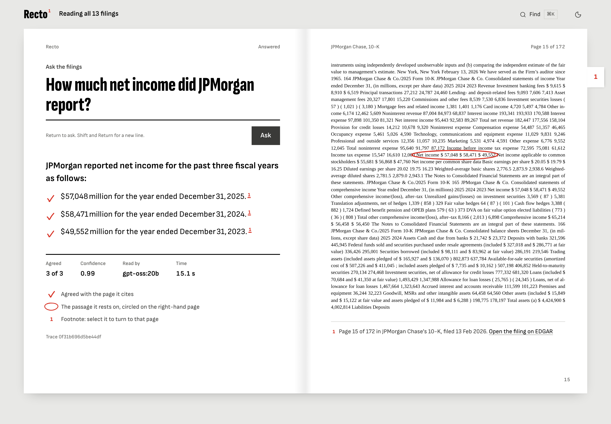
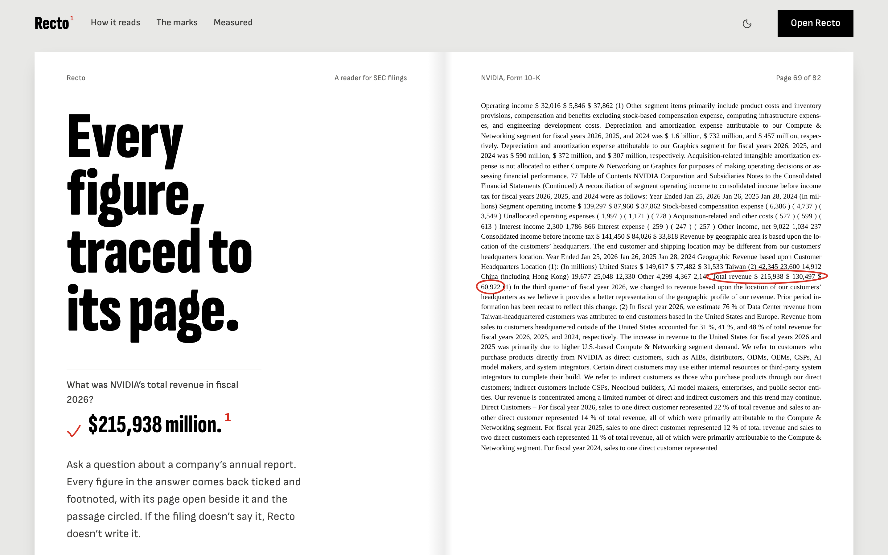
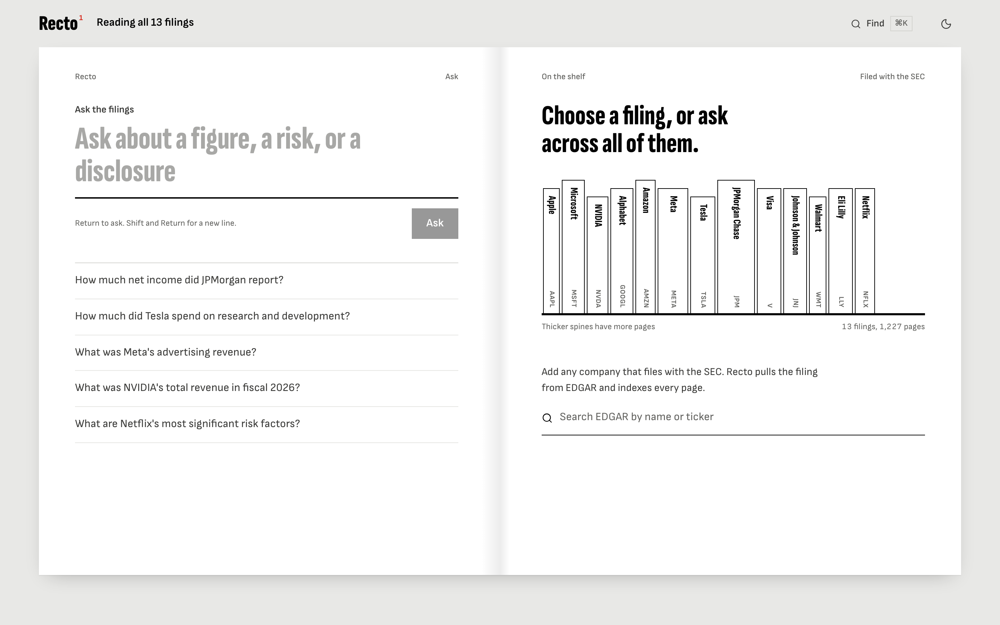
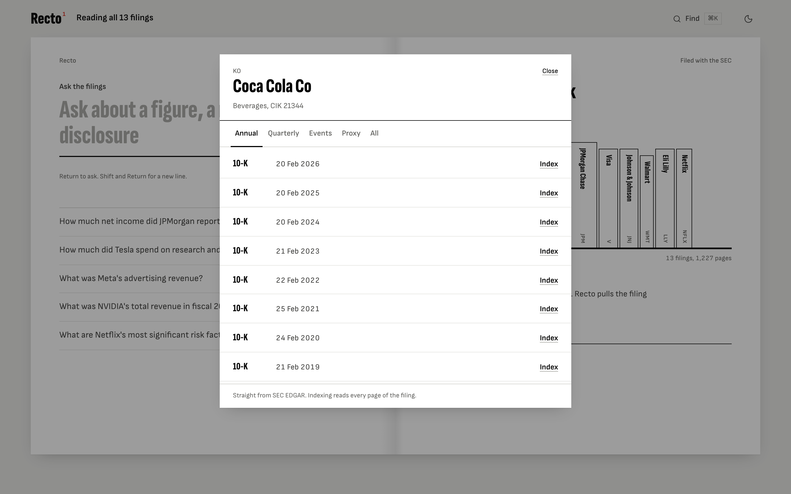
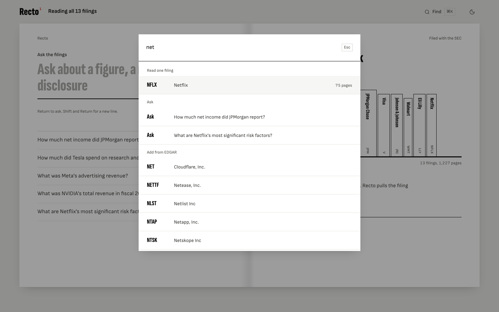

# Recto

**Every figure, traced to its page.** Recto reads SEC filings and answers
questions about them. Each figure in an answer is ticked and footnoted, the
filing page it came from is open beside it with the passage circled, and when
the filing doesn't say something, Recto doesn't write it.

**[Live demo](https://insightledger-opal.vercel.app)** · [open Recto](https://insightledger-opal.vercel.app/app)
· [API health](https://insightledger-edib.onrender.com/health)

_The demo runs on free tiers. The page loads instantly from Vercel's CDN; the
reading service on Render sleeps when idle, so the first question after a quiet
spell waits about a minute for it to wake. Every question after that takes
roughly 7 to 15 seconds with the live model._

Most retrieval projects chunk text, embed it, take the nearest paragraphs and
hand them to a model. Financial filings lose a lot that way: a table's figures
lose their columns, so the model has to guess which year a number belongs to.
Recto keeps the **page** in the loop. It retrieves whole pages, a model reads
them and writes down claims with verbatim quotes, a **verifier** checks every
claim against the page it cites, and the answer is written from verified claims
only, or not at all.

```
router ─▶ retriever ─▶ extractor ─▶ verifier ─┬─(confident)──▶ synthesizer ─▶ answer
                ▲                              │
                └──────────── widen ◀──────────┘ (low confidence: read 3 more pages)
```

## Screenshots

**The answer, facing its page.** The console is an open book: the question and
answer on the left, the filing page it rests on on the right, with the figure
circled in pencil and a thumb-index tab for each source.


**Landing.** The hero is the product: NVIDIA's real page 69, its revenue
figure circled as the page loads.


**Asking.** The shelf shows what's indexed, with each spine's thickness set by
its page count.


**Any company on EDGAR.** Search any filer and index any filing live.


**⌘K.** Jump to a filing, ask a question, or add a company.


---

## Why it's not an API wrapper

| Production concern | How Recto addresses it |
|---|---|
| **Retrieval quality** | Visual late-interaction (MaxSim) over page images, not lossy text |
| **Multi-agent orchestration** | LangGraph graph with a real **verify → re-retrieve** cycle |
| **Hallucination control** | Region-grounded citations + verifier + **abstention** on unanswerable Qs |
| **LLM evaluation** | Golden set + Ragas-style metrics (recall, faithfulness, citation IoU) |
| **LLMOps** | Per-request span traces, cost accounting, **eval-gated CI** |
| **Cost/latency** | Difficulty router sends lookups to a cheap model, reasoning to a strong one |
| **Scalability** | Qdrant native multi-vector store; stateless API; pluggable backends |

## Results (reproducible: `make compare`)

Measured on a 16-item golden set (lookups, cross-page/chart reasoning, and
adversarial *unanswerable* questions) — full numbers in [docs/METRICS.md](docs/METRICS.md):

| Metric | naive text-RAG | Recto | Δ |
|---|---|---|---|
| Retrieval recall@k | 0.938 | **1.000** | +0.062 |
| Faithfulness (grounded) | 0.000 | **1.000** | +1.000 |
| Answer accuracy | 0.812 | **1.000** | +0.188 |
| Citation region IoU | 0.000 | **1.000** | +1.000 |
| Hallucination rate | 0.188 | **0.000** | −0.188 |

_**Reading the numbers honestly:** these are on the deterministic **stub** over a
small, hand-built golden set whose questions are answerable from the corpus — so
the grounded stub scores near-perfectly, and the naive text-RAG baseline (no
region grounding, no verification, no abstention) scores 0 on faithfulness/IoU by
construction. The point isn't "1.000 is state-of-the-art" — it's that the
**harness, metrics, baseline comparison, and CI gate exist and are reproducible**
(`make compare`). Point the same harness at the ColQwen + Claude + Qdrant stack,
or at an LLM-generated eval set (`qagen`), for real-world numbers._

---

## Runs anywhere, scales to production

The entire system runs **with no GPU, no API keys, no external services** via
deterministic *stub* backends, and transparently upgrades to real backends when
their deps + credentials are present. Backend selection is `auto` by default:

### Fully local, no API (default)

Out of the box the app runs **100% on-machine — no API, no key, no external
call**: a deterministic, grounded stub for retrieval + generation. Everything
(full-universe company search, live EDGAR ingest, the multi-agent graph,
citations, eval) works with nothing configured.

| Concern | Stub (default, zero-dep) | Real backend (opt-in) |
|---|---|---|
| Page embeddings | hashed multi-vector + MaxSim | **ColQwen2** visual (local GPU) |
| Vector store | in-process numpy MaxSim (persisted) | **Qdrant** multi-vector (MAX_SIM) |
| LLM | grounded deterministic heuristics | **gpt-oss on Ollama Cloud** (`OLLAMA_API_KEY`) or **Claude** (`ANTHROPIC_API_KEY`) |
| Graph | LangGraph if installed, else linear | **LangGraph** cycle |
| Ingestion | synthetic fixture (eval only) | **SEC EDGAR** live filings (default) |

```bash
insightledger backends   # -> {"embedder":"stub","vector_store":"memory","llm":"stub","graph":"langgraph"}
```

**LLM tier.** `IL_LLM=auto` runs the fully local stub by default. Set
`OLLAMA_API_KEY` to read with **gpt-oss on Ollama Cloud**: `gpt-oss:20b` for
lookups and verification, `gpt-oss:120b` for questions that need reasoning
across pages. Both are env vars (`IL_OLLAMA_MODEL`, `IL_OLLAMA_MODEL_CHEAP`),
so moving to Kimi is a config change once the account has credits. Setting
`ANTHROPIC_API_KEY` uses Claude instead. Whatever the model writes is checked
against the pages before it reaches you: a claim must quote its page verbatim,
the verifier judges each claim against its own page only, and any citation the
model invents is removed. A failed or rate-limited call falls back to the
stub for that step instead of failing the request.
**Never commit an API key**: `.env` is gitignored, `.env.example` is the template.

## Quickstart

```bash
pip install -r requirements.txt          # core deps only (~fast)
export PYTHONPATH=src                     # or: pip install -e .
export IL_EDGAR_USER_AGENT="Your Name you@example.com"   # SEC fair-access policy

make serve                                # web UI + API at http://localhost:8000
                                          #   ↳ ingests 30 companies' 10-Ks live on first boot
make eval                                 # eval harness + CI gate (labelled fixture, offline)
make compare                              # text-RAG baseline vs Recto
```

The app runs on **live SEC EDGAR filings — no mock data**. First boot ingests
the thirty seed tickers (`IL_SEED_TICKERS`: large filers across tech, finance,
consumer, health and energy, from Apple to Chevron), and seeds added later are
ingested on the next boot. **Every other company on EDGAR is a question away**:
name one and Recto fetches its latest annual report before answering, or browse
all 8,032 listed companies A to Z inside the app (`GET /companies`), or search
every filer with or without a ticker. Fetched filings beyond `IL_MAX_FETCHED` are
evicted least-recently-used; seeds never are.

Modern 10-Ks are inline-XBRL, so ingestion parses with BeautifulSoup/lxml,
strips the XBRL header, and keeps the **whole** filing in its own order, cover
page included, splitting only where an "Item" heading starts a line (97–100% of
the text across large filers; JPMorgan's runs to 314 pages). A 10-K that
incorporates its statements from the annual report to shareholders (IBM's) is
read with that Exhibit 13.

> The eval harness uses a small labelled synthetic corpus as a **test fixture**
> (it needs ground-truth page/region answers) in an isolated index — it is never
> served by the app.

Ask a question from the CLI:

```bash
python -m insightledger.cli query \
  "Which segment drove ACME's operating margin improvement and by how much did it grow?"
```

```
ANSWER:
Based on the retrieved pages:
- Operating margin was 18.4% in fiscal 2024 ... an improvement of 3.3 percentage points. [ACME-10K-2024 p.3]
- The Cloud Robotics segment drove the improvement, with revenue growing 42% year over year ... [ACME-10K-2024 p.3]

CITATIONS:
  - ACME-10K-2024 p.3 bbox={'x0': 0.06, 'y0': 0.34, 'x1': 0.94, 'y1': 0.65}
difficulty=complex confidence=1.00 model=stub retries=0 cost=$0.000000 latency=... trace=...
```

## Web UI

`make serve`, then open <http://localhost:8000>. The interface is designed as a
marked-up proof, and one colour rule carries it: **black ink is the filing's
own words, red pencil is Recto's judgement.**

- **The spread.** The console is an open book. The verso holds the question and
  the answer; the recto holds the filing page the answer rests on, typeset from
  the page's real text, with the cited passage circled in a hand-drawn pencil
  loop. Thumb-index tabs on the fore-edge turn between sources.
- **Live stages.** While a question runs, each stage (route, pull pages, read,
  check, write) is ticked off as the server reports it over Server-Sent
  Events, and the recto lists the pages being read.
- **Marks.** A tick means a claim agreed with its page, a loop marks where it
  rests, a strike-through marks a claim the verifier left out, and a cross
  means nothing was written because no page answered the question.
- **The shelf.** Indexed filings stand as spines, thick in proportion to their
  page count. Add any EDGAR filer from the same page.
- **Type.** Sofia Sans Extra Condensed for display, Sofia Sans for the
  interface, and Tinos (metric-compatible with the Times New Roman EDGAR uses)
  for anything quoted from a filing. Light and dark, responsive down to phones,
  reduced motion respected.

The built assets are committed, so **the UI runs with just Python**. To develop
the frontend:

```bash
cd frontend
npm install
npm run dev        # hot-reload on :5173, proxies the API to :8000
npm run build      # rebuilds into src/insightledger/api/static/
```

## Go live (real backends)

```bash
pip install -e ".[vision,llm,qdrant]"     # ColQwen + Claude + Qdrant
export ANTHROPIC_API_KEY=sk-...            # -> llm=claude (Opus/Haiku routing)
export IL_EDGAR_USER_AGENT="Your Name you@example.com"
python scripts/ingest_live.py AAPL MSFT --form 10-K   # real SEC filings
docker compose up --build                  # app + Qdrant
```

## API

| Route | Purpose |
|---|---|
| `GET /` · `/app` | landing page · the reading console |
| `POST /query` | `{question, top_k?, doc_ids?}` → grounded `Answer` |
| `POST /query/stream` | same, reported stage by stage as Server-Sent Events, then the answer |
| `POST /ingest` | `{ticker, form?, accession?}` → index the latest (or a specific) EDGAR filing |
| `GET /tickers?q=` | search the entire EDGAR universe (~1M filers, ticker or CIK) |
| `GET /companies` | every company with a ticker on EDGAR, one row each, A to Z |
| `GET /company?ticker=` | company profile + full filing history (browse any filing) |
| `GET /documents` · `/documents/{id}` | corpus + page/region/section detail |
| `GET /documents/{id}/pages/{n}` | one page with its place in the filing |
| `GET /trace/{trace_id}` | per-request agent span trace |
| `GET /health` · `POST /eval` | backends/index size · run the gate |

## Layout

```
src/insightledger/
  config.py              backend selection (auto → real|stub)
  schemas.py             pydantic contracts (BBox, Region, Claim, Answer, Eval*)
  ingestion/             EDGAR client, layout regions, synthetic corpus
  retrieval/             ColQwen|stub embedder, Qdrant|memory store, indexer
  llm/                   Claude|stub provider (difficulty routing, VLM read, verify)
  agents/                LangGraph orchestrator (router→retrieve→extract→verify⟲→synth)
  eval/                  golden set, metrics, harness + CI gate, text-RAG baseline
  observability/         span tracing + token-cost accounting
  api/                   FastAPI service + built-in web UI
tests/                   16 tests: schemas, retrieval, agents, eval, api
docs/METRICS.md          auto-generated eval report
```

See [docs/ARCHITECTURE.md](docs/ARCHITECTURE.md) for the design walk-through.

## Tech

Python · pydantic · LangGraph · FastAPI · numpy · ColQwen2 (ColPali) ·
Qdrant · Anthropic Claude · SEC EDGAR · pytest

## License

MIT

## Deployment

The app is one FastAPI service that also serves the built React frontend, so
`make serve` (or the Dockerfile) is enough to run everything. The hosted demo
splits the two for speed:

| Piece | Host | Notes |
|---|---|---|
| Frontend (`/`, `/app`) | Vercel | Static build on the CDN; loads instantly |
| API (`/query`, `/query/stream`, `/documents`, …) | Render | Docker, free plan, sleeps when idle |

`vercel.json` rewrites the API paths from the Vercel domain to the Render
service, so the frontend keeps using relative URLs and needs no CORS setup.

The Docker build ingests all thirty seed filings from EDGAR and bakes the
index into the image (about 3,900 pages, ~200 MB resident once loaded), along
with EDGAR's list of every filer, so a cold start loads from disk in about a
second instead of re-fetching filings. Each distinct vector row is stored once,
page regions are derived from text rather than stored, and a fetched filing
costs about its own size in memory. The model key is a Render environment variable, never part of the
image or the repository.

Vercel redeploys automatically on push to `main`. The Render service was
created through the API rather than the dashboard, so it has no GitHub webhook
and does **not** auto-deploy: redeploy it from the Render dashboard, or connect
the repo there once to turn auto-deploy on.

To run the whole thing yourself with no hosting at all:

```bash
make install && make serve   # http://localhost:8000
```
